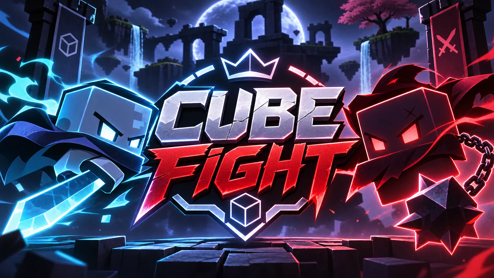

# ⚔️ Cube Fight



**Cube Fight** é um jogo de arena 2D para navegador, com partidas locais entre **dois jogadores** ou **jogador contra bot**. Feito com HTML, CSS, JavaScript e Canvas.

**[🎮 Abrir o jogo no GitHub Pages](https://v-prof1.github.io/CubeFight/)** — este endereço funciona quando a publicação pelo GitHub Pages está habilitada.

## Recursos

- **20 armas**, com estilos corpo a corpo, distância, arremessáveis, ativáveis e armadilhas
- **Ataque básico (M1) e habilidade especial separados**, com recargas independentes
- Sistema de **counters**, escudo e **parry** pelo movimento para baixo
- **15 arenas** com armadilhas e mecânicas próprias
- **Modo Infinito** com troca de arena a cada cinco mortes somadas
- Bots fácil, médio e difícil
- Compatível com teclado, controles Gamepad e toque, inclusive combinações mistas
- Editor de HUD exclusivo para mobile
- Armas e projéteis com sprites animados
- Placar final e personalização dos cubinhos

## Como jogar

| Comando | Jogador 1 | Jogador 2 |
| --- | --- | --- |
| Movimento, pulo e defesa | WASD | Setas |
| M1 | F | / |
| Especial | G | . |
| Controle | Analógico / RT-R2 / RB-R1 | Segundo gamepad: mesmos botões |
| Mobile | Joystick + ATACAR + SKILL no próprio lado | Joystick + ATACAR + SKILL no próprio lado |

**Escudo e parry:** mover para baixo ativa a defesa; se o movimento ocorrer no instante do impacto, realiza o parry.

## Estrutura

```
index.html
manifest.webmanifest
sw.js
assets/
  Cube_Fight_Armas_Sprites.png
  Cube_Fight_Projeteis_Sprites.png
  cube-fight-fullscreen.webp
  cube-fight-portrait.webp
  favicon.svg
  icon-180.png
  icon-192.png
```

## Publicar no GitHub Pages

1. Abra **Settings → Pages** no repositório.
2. Em **Build and deployment**, escolha **Deploy from a branch**.
3. Selecione a branch **main** e a pasta **/(root)**.
4. Salve. O jogo ficará disponível em **https://v-prof1.github.io/CubeFight/** após a publicação.

Este projeto também inclui **manifesto web e service worker**, preparados para acesso offline depois da primeira visita em navegadores compatíveis.

## Atualizações

Versão atual: **8.0 — Arsenal Animado**, preservando os personagens originais e adicionando sprites às armas e aos projéteis.

---
Projeto desenvolvido para o portfólio de **V-prof1**.
